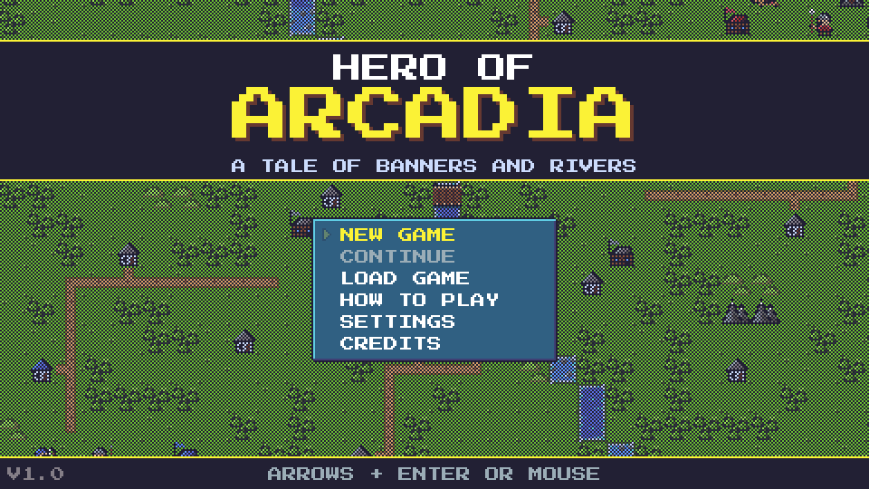
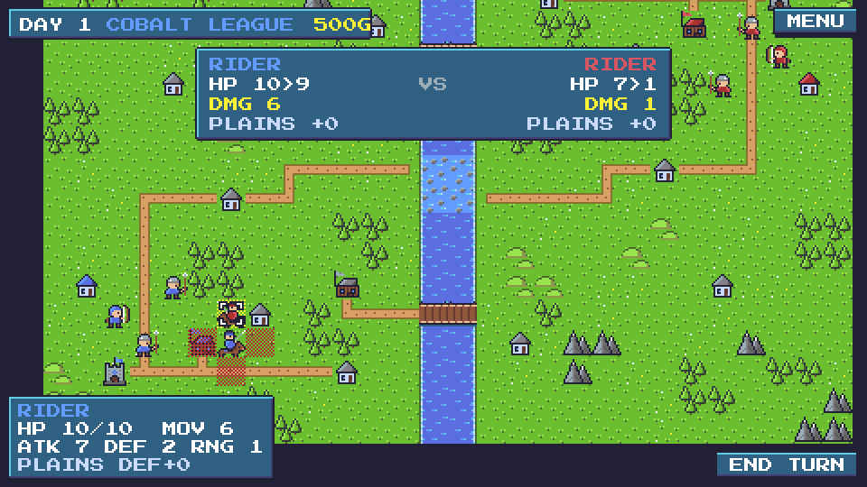
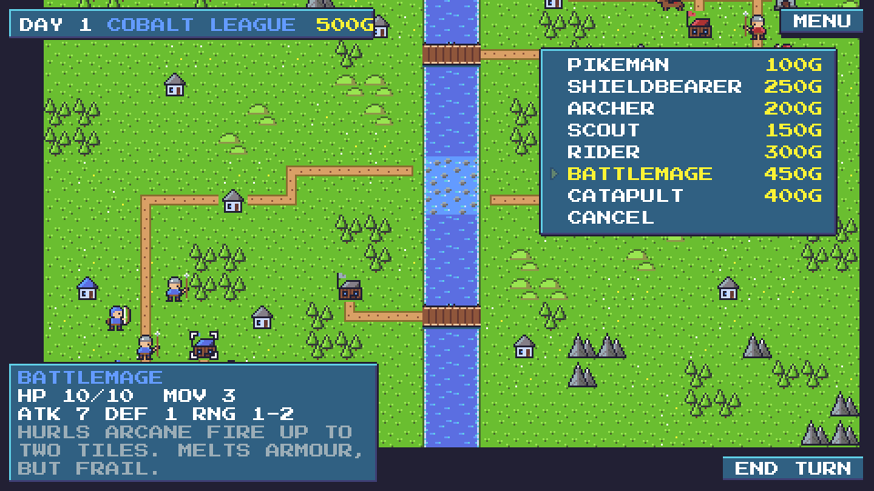
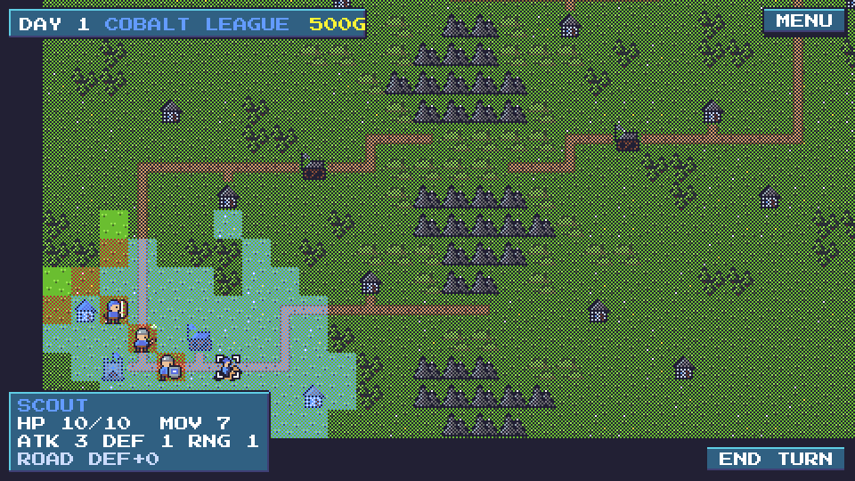
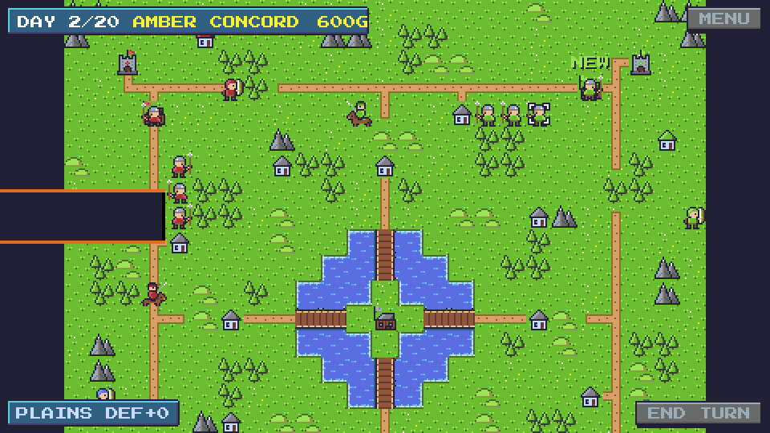

# Hero of Arcadia

A retro pixel-art, turn-based tactics game for the browser and desktop. Lead the Cobalt
League across hand-made battlefields: move, fight, capture and build until one banner stands.



| | |
| --- | --- |
|  |  |
|  |  |

**Play in the browser:** https://bhimio1.github.io/hero-of-arcadia/ (once GitHub Pages is
enabled, see [Releases](#releases)). Desktop installers are attached to tagged releases.

## Features

- Eight factions, each with its own perks and most with a unique unit.
- Five hand-made maps, from a quick skirmish to a four-army free-for-all, plus endless
  random maps: pick a biome, size, number of armies and building density, then a seed.
- Twelve unit types with distinct roles and matchups, all defined in JSON.
- Mod support: JSON mods add or change units, factions, terrain, maps, biomes and rules,
  with their own pixel sprites. Import them in the game's Mods screen; three example mods
  are included. See [MODDING.md](MODDING.md).
- Economy: villages, barracks and keeps pay gold, heal troops and can be captured.
- Fog of war with forest ambushes, high-ground vision and scouts.
- An AI opponent that plays by the same rules and only sees what its army sees.
- Hot-seat play for up to four people, with a handover screen when fog is on.
- Save slots, an always-current autosave, and saves that can be replayed move by move.
- Combat preview, undo for moves, threat ranges, optional luck and day limits.
- Everything drawn in code from pixel grids: DawnBringer 32 palette, 480×270 at
  whole-number zoom, chiptune sounds synthesised with Web Audio.

## How to play

- Each day every army takes a turn. Move each unit once, then **attack**, **capture** or **wait**.
- **Win** by capturing the enemy keep, or by destroying every unit they have while they
  have no barracks left to recruit from. With a day limit, the best score wins
  (army value plus 100 per building held).
- **Villages, barracks and keeps** pay gold every turn and heal your units standing on
  them by 2 HP. Pikemen and shieldbearers capture them: a healthy unit needs two turns,
  a badly wounded one up to four, and walking away resets the progress.
- **Barracks** raise one unit per turn while the yard is clear. New units act next turn.
- **Combat:** damage = attack × matchup bonus × attacker health × (1 − 10% per point of
  defense). Terrain adds defense. A surviving defender strikes back if the attacker is in
  its range, so archers, catapults and battlemages firing from 2+ tiles take no reply from
  melee units. Catapults can't move and fire in the same turn.
- **Fog of war:** you see what your units see. Hills (+1) and mountains (+2) extend
  sight; forests hide units from anyone not adjacent. Walking into a hidden enemy is an
  ambush: the move stops and that unit's turn is over.

The game has a **How to Play** screen with these rules and live unit/terrain tables.

### Units

| Unit | Cost | HP | ATK | DEF | Move | Range | Vision | Notes |
| --- | ---: | ---: | ---: | ---: | ---: | :---: | ---: | --- |
| Pikeman | 100 | 10 | 5 | 2 | 3 (foot) | 1 | 2 | Cheap and sturdy. Captures buildings. Braces against riders. |
| Archer | 200 | 10 | 5 | 1 | 3 (foot) | 2 | 3 | Shoots 2 tiles away. Helpless when enemies close in. |
| Rider | 300 | 10 | 7 | 2 | 6 (mounted) | 1 | 3 | Fast shock cavalry. Slowed by forests, stopped by mountains. |
| Catapult | 400 | 10 | 8 | 1 | 4 (wheeled) | 2–3 | 2 | Must stand still to fire. Never strikes back. |
| Scout | 150 | 10 | 3 | 1 | 7 (mounted) | 1 | 5 | Swift outrider with keen eyes. Sees far through the fog. |
| Shieldbearer | 250 | 10 | 4 | 4 | 3 (foot) | 1 | 2 | Heavy infantry behind a tower shield. Shrugs off arrows. Captures. |
| Battlemage | 450 | 10 | 7 | 1 | 3 (foot) | 1–2 | 3 | Hurls arcane fire up to two tiles. Melts armour, but frail. |

Faction-only units: **Berserker** (Ember, replaces Shieldbearer), **Ranger** (Moss,
replaces Archer, range 2–3), **Hexer** (Violet, replaces Catapult), **Corsair** (Tide,
replaces Scout, captures), **Knight** (Ivory, replaces Rider).

### Factions

| Faction | Perks | Unique unit |
| --- | --- | --- |
| Cobalt League | Shieldbearers cost 50 less, +1 defense; infantry +1 defense on roads and bridges | – |
| Ember Host | Cavalry +1 attack and +1 move; income −10% | Berserker |
| Moss Wardens | Forests cost 1 to enter and give +1 extra defense | Ranger |
| Amber Concord | +25% income; siege units cost 25% less | – |
| Violet Covenant | Magic units cost 100 less; every unit +1 vision | Hexer |
| Tide Wardens | Foot units wade rivers (cost 3), fords cost 1; +2 defense in water | Corsair |
| Fen Clans | Units heal 1 HP every turn anywhere (+1 more on buildings); pikemen cost 20 less | – |
| Ivory Order | +2 defense on your own buildings | Knight |

Pick factions per army on the second page of **New Game** (left/right cycles factions).

### Terrain

| Terrain | Defense | Foot | Mounted | Wheeled |
| --- | ---: | ---: | ---: | ---: |
| Plains, road, bridge | +0 | 1 | 1 | 1 |
| Forest (hides units) | +2 | 1 | 2 | 3 |
| Hills (+1 vision) | +2 | 2 | 2 | 3 |
| Mountain (+2 vision) | +4 | 3 | – | – |
| Ford | −1 | 2 | 2 | – |
| River | – | – | – | – |
| Keep / barracks / village | +4 / +2 / +2 | 1 | 1 | 1 |

### Maps

| Map | Size | Armies | Notes |
| --- | --- | --- | --- |
| First Ford | 28×18 | 2 | River valley with bridges, a ford and 18 buildings. The default. |
| Greenvale | 20×13 | 2 | Pure skirmish, no buildings: rout the enemy. |
| Highland Pass | 30×20 | 2 | Fog. A mountain wall with three passes. |
| Wildwood | 32×22 | 2 | Fog. Dense forest and a winding stream. |
| Four Crowns | 25×25 | 4 | Free-for-all around a lake with an island barracks. |

**Random maps** (New Game → Map → RANDOM) are generated from a seed and a biome
(Temperate, Woodland, Highlands, Riverlands, Steppe). They are symmetric, so every army
gets the same ground (a half turn for two armies, a quarter turn for four), and a road
with bridges always links every keep. The same options and seed always give the same
map, and generated maps are stored inside saves so they load even if the generator
changes.

### Controls

| Input | Action |
| --- | --- |
| Left click | Select a unit, choose a destination, pick a menu entry or target |
| Click an enemy | Show the tiles it can threaten this turn |
| Click your barracks | Open the build menu |
| Drag, arrows, WASD | Pan the camera |
| Space | End turn (asks first if units can still act) |
| Enter | Confirm a menu entry, or attack the previewed target |
| Tab | Select the next ready unit (cycle targets while aiming) |
| Esc, right click | Cancel; after moving, undo the move; otherwise open the pause menu |
| Ctrl+Z | Undo the last move (before the unit acts) |

## Running it

```sh
npm install
npm run dev      # http://localhost:5173
```

| Command | What it does |
| --- | --- |
| `npm test` | Unit tests (Vitest) for the rules engine, AI, saves and data files |
| `npm run lint` | ESLint plus a full TypeScript type check |
| `npm run build` | Production web build into `dist/` |
| `npm run preview` | Serve the production build |
| `npm run desktop:dev` | Run the desktop app (needs Rust and the [Tauri prerequisites](https://v2.tauri.app/start/prerequisites/)) |
| `npm run desktop:build` | Build desktop installers for the current OS |

## Project layout

```
src/
  core/          Rules engine: plain TypeScript, no Phaser, no DOM (enforced by ESLint)
    rules.ts       applyAction(state, action) -> { state, events }: the only way to change a game
    pathfinding.ts Dijkstra movement ranges, paths, distance fields
    procgen.ts     seeded random map generator (biomes from biomes.json)
    content.ts     content packs: layering (add, patch, remove) and validation
    stats.ts       faction perks applied to units, costs, movement, income...
    mods.ts        mod files: parsing, load order, isolating broken mods
    combat.ts      damage, counters, previews, threat ranges
    fog.ts         visibility and per-player views
    match.ts       action log, undo
    save.ts        save/load, replay and verification, save slots
    ai/            AiController interface and the greedy AI
  game/          Phaser: scenes, rendering, input, UI, audio
  data/          JSON content: units, terrain, buildings, factions, biomes, rules, maps, sprites
public/mods/     Example mods shipped with the game (listed in index.json)
src-tauri/       Desktop wrapper (Tauri 2)
.github/         CI, GitHub Pages deploy, desktop release builds
```

Design notes:

- **Pure rules.** The game state is plain JSON. `applyAction` never mutates its input and
  returns a list of events (moved, attacked, died, captured, ...) that the renderer animates.
  The UI and the AI both go through it, so they can't diverge from the rules.
- **Deterministic.** A seeded RNG lives in the state (used when *luck* is on), so any game
  can be rebuilt from its setup + action log. Saves store both and are verified on load.
- **No cheating AI.** AI players are handed `playerView(state, player)`, which strips
  enemy units hidden by fog. The AI is behind an interface (`src/core/ai/types.ts`) so a
  smarter one can be dropped in.
- **Data-driven.** Units, terrain, buildings, factions, biomes, rules and maps are JSON;
  faction perks are data too (effects such as "+1 move for cavalry"). The base game is
  just the first content layer and mods are further layers on top, validated as a whole;
  a mod that would break the content is left out with its reasons. The AI's build
  choices and the How to Play pages are computed from the active content.

## Modding

Mods are JSON files that add or change content; the full guide is [MODDING.md](MODDING.md).
In short:

- **Play with mods:** Main menu → **Mods**. Turn the bundled example mods on, or
  **Import mod file** to add your own. Saves remember which mods they need.
- **Make a mod:** a file with `"format": "hero-of-arcadia-mod"`, an `id`, `name` and
  `version`, plus `content` (units, factions, terrain, buildings, biomes, maps, rules),
  optional `remove` lists and `sprites`. Entries with an existing id are patched, so
  `{ "id": "catapult", "cost": 500 }` is a complete change.
- **Ship mods with the game:** drop them in `public/mods/` and list them in
  `public/mods/index.json`.

Changing the base game works the same way, directly in `src/data/`: maps in
`src/data/maps/*.json` are picked up automatically, and sprites are 16×16 pixel grids in
`src/data/sprites/<folder>/<id>.json` (`1`, `2`, `3` are the team colour ramp). `npm test`
validates all of it and plays every map and bundled mod with the AI.

**Hand-drawn art:** to replace a unit or building with a PNG, add it to
`src/data/sprites/overrides.json`, e.g. `"units/pikeman": "sprites/units/pikeman.png"`, and
put the file under `public/`. The PNG is a horizontal strip of 16×16 frames in the same order
as the sprite's JSON (`idle` frames, then `attack`). Paint team-coloured parts with the
Cobalt ramp (`#639bff`, `#5b6ee1`, `#3f3f74`); they are recoloured for every army.

## Releases

- **CI** (`.github/workflows/ci.yml`) runs lint, tests and a build on every branch push and
  pull request.
- **Web:** every push to `main` runs the checks and deploys `dist/` to GitHub Pages
  (`.github/workflows/pages.yml`). One-time setup: repository **Settings → Pages → Build and
  deployment → Source: GitHub Actions**.
- **Desktop:** pushing a tag such as `v1.0.0` builds Windows (`.msi`, `.exe`), macOS (`.dmg`
  for Apple Silicon and Intel) and Linux (`.deb`, `.rpm`, `.AppImage`) installers with
  Tauri and attaches them to a draft GitHub release (`.github/workflows/release.yml`):

  ```sh
  git tag v1.0.0 && git push origin v1.0.0
  ```

  The builds are unsigned, so Windows SmartScreen and macOS Gatekeeper will warn on first
  launch (on macOS: right-click the app → Open).

## Credits

- Font: [Press Start 2P](https://fonts.google.com/specimen/Press+Start+2P) by CodeMan38,
  SIL Open Font License 1.1 (bundled via `@fontsource/press-start-2p`).
- Palette: DawnBringer 32 by DawnBringer.
- Engine: [Phaser 3](https://phaser.io); desktop shell: [Tauri](https://tauri.app).

All game art, sound, names and rules were made for this project.
